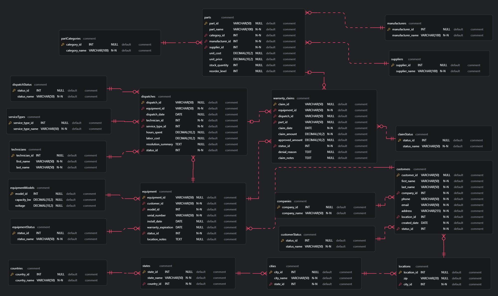

# Gigavolt

## Schema ERD

## Stopping instances safely

## Starting instances safely

## Remote SSH
1. Download .pem
2. Permissions: User(Read-Only), Groups(None), Others(None)
3. Connect: ssh -i /home/kaushal/Downloads/labsuser.pem ubuntu@public_ip
