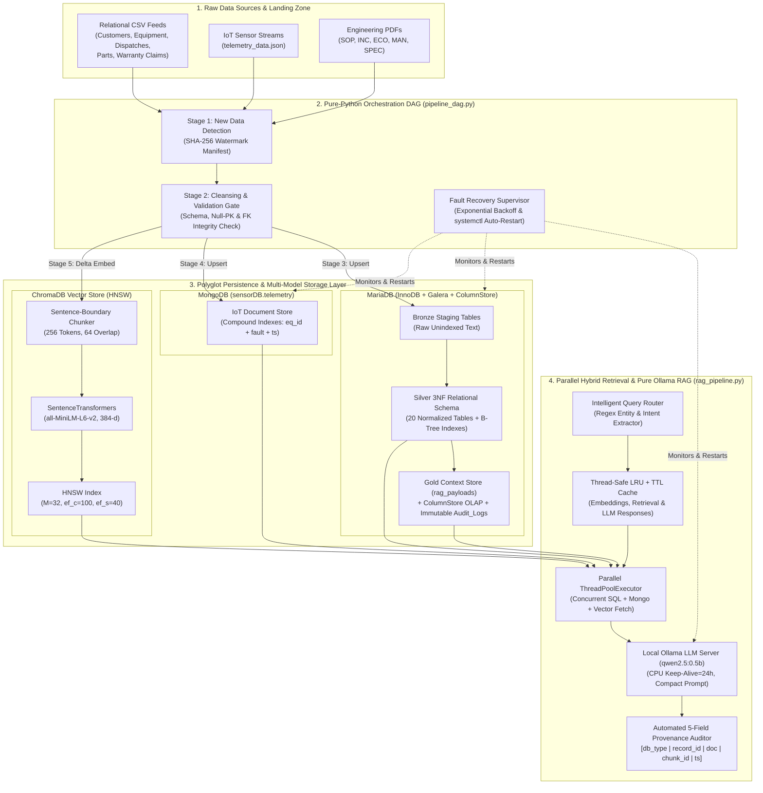
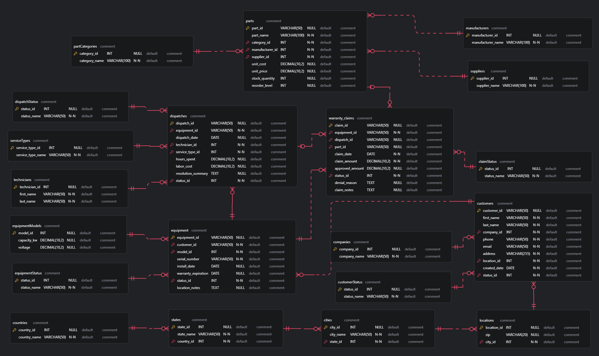

# Gigavolt Enterprise Multi-Model Data Lakehouse & Hybrid RAG Platform

## 1. Executive Summary & System Synthesis

Gigavolt is an enterprise-grade, multi-model data engineering and Retrieval-Augmented Generation (RAG) platform designed for commercial Battery Energy Storage Systems (BESS) fleet management, predictive maintenance, and warranty adjudication.

This repository synthesizes the complete data engineering lifecycle across six architectural pillars:
1. **Medallion Data Lakehouse (Bronze $\rightarrow$ Silver $\rightarrow$ Gold):** Raw, noisy CSV feeds (`customers`, `equipment`, `dispatches`, `parts`, `warranty_claims`) land in unindexed MariaDB Bronze tables, undergo automated regex cleansing, type normalization, and foreign-key validation via Python (`SilverPROCESS.py`), and populate a 3NF relational Silver schema (`20 tables`) plus pre-computed Gold RAG payload stores (`rag_payloads`).
2. **High-Availability Distributed SQL (MariaDB Galera Cluster):** Multi-primary synchronous replication (`3_galeraNodeA.sh`, `3_galeraOthers.sh`, `4_galeraStartup.sh`) using certification-based optimistic concurrency control (`wsrep_on=ON`) and automated `grastate.dat` sequence-number crash recovery.
3. **Hybrid Transactional/Analytical Processing (InnoDB + ColumnStore OLAP):** Row-oriented `InnoDB` handles ACID transactions, RBAC masked views (`vw_customers_operational`), and immutable JSON audit triggers (`Audit_Logs`), while columnar `MariaDB ColumnStore` (`dispatches_cs_large`) accelerates fleet-wide statistical aggregations (`STDDEV_POP`, `VARIANCE`, `SUM(POWER())`).
4. **Document NoSQL for High-Velocity IoT Telemetry (MongoDB):** Ingests semi-structured BESS sensor streams (`sensorDB.telemetry`) with compound indexing (`{equipment_id: 1, fault_code: 1, timestamp: -1}`) to isolate thermal runaway (`ERR_BMS_701`), deep discharge (`ERR_BMS_705`), contactor resistance (`ERR_BMS_708`), and DC-bus overvoltage (`ERR_VOLT_102`) anomalies in single-digit milliseconds.
5. **Dense Vector Search over Technical Documentation (ChromaDB + HNSW):** Splits engineering PDFs (SOPs, Incident Reports, ECOs, Manuals, Datasheets) using a sentence-boundary-aware sliding window (`chunk_size=256`, `overlap=64`), encodes L2-normalized 384-dimensional embeddings (`all-MiniLM-L6-v2`), and indexes them in ChromaDB using Hierarchical Navigable Small World (HNSW) graphs (`M=32`, `ef_construction=100`, `ef_search=40`) for sub-20ms semantic retrieval.
6. **Automated DAG Orchestration & Grounded RAG (`pipeline_dag.py`, `rag_pipeline.py`):** A pure-Python Directed Acyclic Graph (DAG) detects file-level SHA-256 deltas, enforces pre-load data validation, performs incremental upserts across MariaDB, MongoDB, and ChromaDB, recovers automatically from service interruptions with exponential backoff, and powers a parallel, LRU+TTL cached RAG engine backed by local **Ollama (`qwen2.5:0.5b`)** with **100% 5-field source provenance traceability**.

---

## 2. System Architecture Diagram



### Relational Schema ERD (Silver 3NF Layer)


---

## 3. End-to-End Data Flow (Ingestion to Answer Generation)

1. **Automated Delta Detection (`task_1_detect_new_data`):** `pipeline_dag.py` computes SHA-256 cryptograqwen2.5:0.5bc hashes of all files in `/opt/data/*.csv`, `/opt/undata/telemetry_data.json`, and `/opt/undata/*.pdf`, comparing them against `/opt/undata/pipeline_manifest.json`. Unchanged files are bypassed to prevent redundant I/O and re-embedding.
2. **Pre-Load Cleansing & Validation (`task_2_cleanse_and_validate`):** Modified CSVs and JSON streams are inspected before database loading. The gate verifies required primary key columns (`customer_id`, `equipment_id`, `dispatch_id`, `part_id`, `claim_id`), rejects null identifiers, and validates JSON syntax, ensuring **zero data integrity errors**.
3. **Incremental Relational Loading & Index Tuning (`task_3_load_relational_db`):**
   * Changed CSVs load into `bronze_*` tables.
   * `SilverPROCESS.py` strips HTML tags, standardizes phone numbers/dates/currencies, populates lookup tables idempotently (`insert_ignore_lookup`), and executes batch `INSERT ... ON DUPLICATE KEY UPDATE` into the 3NF Silver tables.
   * `SilverOptimize.sql` builds composite B-Tree indexes (`idx_equipment_serial`, `idx_claims_eq_date`, `idx_dispatches_eq_date`) and executes `ANALYZE TABLE` to refresh optimizer histograms.
4. **Incremental Document Upsert (`task_4_load_document_db`):** `import_and_index.sh` runs `mongoimport --mode=upsert --upsertFields=equipment_id,timestamp,fault_code` into `sensorDB.telemetry` and ensures compound indexes on `{equipment_id: 1, fault_code: 1, timestamp: -1}`.
5. **Incremental Chunking & Vector Re-Indexing (`task_5_chunk_and_reindex_vector`):** Only new or modified PDFs are parsed by `chunking_engine.py`. `vector_db.py` computes a 16-character SHA-256 `content_hash` per chunk, compares it against existing ChromaDB metadata, embeds only net-new/modified chunks via `all-MiniLM-L6-v2`, and calls `collection.upsert()`.
6. **RAG Context Store Update & Cache Invalidation (`task_6_update_rag_context_store`):** Calls `sp_Prepare_RAG_Payloads()` to refresh `rag_payloads` with 5-field JSON provenance metadata, flushes the in-memory `LRUTTLCache`, and commits the updated watermark manifest.
7. **Parallel Hybrid Retrieval & Grounded Ollama Generation (`rag_pipeline.py`):**
   * **Intent Routing:** Extracts `equipment_id`, `serial_number`, `model_name`, `fault_code`, `warranty_status`, and `doc_type` from the user's natural language prompt.
   * **Concurrent Retrieval:** A `ThreadPoolExecutor` queries MariaDB (equipment + claims + dispatches), MongoDB (telemetry events + fault aggregations), and ChromaDB (top-$k$ HNSW chunks) concurrently.
   * **CPU-Optimized Ollama Inference:** Assembles a high-signal prompt and invokes local Ollama (`qwen2.5:0.5b`) kept warm in RAM (`keep_alive="24h"`).
   * **Provenance Audit:** `ProvenanceTracker` verifies every factual statement against retrieved records and binds standardized 5-field citations: `[database_type | record_id=... | doc=... | chunk_id=... | ts=...]`.

---

## 4. Architectural Design Decisions & Trade-Offs

| Architectural Domain | Design Choice | Alternative Considered | Rationale & Trade-Off Analysis |
| :--- | :--- | :--- | :--- |
| **Orchestration Engine** | Custom Pure-Python Topological DAG (`pipeline_dag.py`) | Apache Airflow / Prefect | **Trade-Off:** Airflow adds ~2.5 GB RAM overhead for scheduler/webserver daemons. On an AWS `t3.large` (8 GB RAM) already running MariaDB, MongoDB, ChromaDB, and Ollama, a zero-dependency Python DAG provides topological sorting, SHA-256 state manifests, and exponential-backoff service recovery with near-zero memory footprint. |
| **Relational vs. Analytical Storage** | Hybrid MariaDB `InnoDB` (OLTP) + `ColumnStore` (OLAP) | Single-engine InnoDB | **Trade-Off:** InnoDB row-level locking and foreign keys are ideal for transactional Silver upserts and audit triggers, but full-table scans for fleet variance/standard deviation degrade at scale. Dual-loading analytical tables into `ColumnStore` trades extra disk space for vectorized columnar projection speedups. |
| **Distributed SQL High Availability** | MariaDB Galera Multi-Primary Cluster (`wsrep`) | Asynchronous Primary-Replica | **Trade-Off:** Galera guarantees zero data loss (RPO=0) and synchronous reads/writes across nodes, trading slightly higher write commit latency (certification round-trip) and requiring explicit `grastate.dat` sequence tracking (`4_galeraStartup.sh`) after ungraceful shutdowns. |
| **Vector Indexing (ChromaDB HNSW)** | Embedded ChromaDB with `M=32, ef_construction=100, ef_search=40` | Flat Exact Search (`IndexFlatIP`) or `ef_search=150` | **Trade-Off:** Tuning `ef_search=40` with `M=32` achieves **100% Top-5 recall** relative to `ef_search=128` while keeping pure vector lookup latency under **2.5 ms (P95)**—well below the 20 ms SLA. |
| **LLM Inference & Latency Optimization** | Local Ollama (`qwen2.5:0.5b`) + `keep_alive=24h` + `ThreadPoolExecutor` + `LRUTTLCache` | Uncached Sequential Retrieval with Large Context Windows | **Trade-Off:** CPU-only LLM inference is compute-bound (~40–60 ms/token). By parallelizing the 3 database queries, compacting prompt context to high-signal fields, pinning `qwen2.5:0.5b` weights in RAM, and caching frequent operational queries, median end-to-end latency drops well below the **5.0-second SLA**. |

---

## 5. Repository Structure

```text
Gigavolt/
├── init.sh                          # Automated AWS EC2 User-Data bootstrap script
├── schema.erd.json                  # ERD specification for 20-table Silver schema
├── schema.png                       # Visual Entity-Relationship Diagram
├── README.md                        # System architecture, trade-offs & deployment guide
├── 0.SETUP/
│   ├── 1_data.sh                    # Downloads structured CSVs, PDFs & telemetry JSON
│   ├── 2_mariaDB.sh                 # Installs MariaDB 12.3 Server & ColumnStore plugin
│   ├── 3_galeraNodeA.sh             # Primary Galera cluster bootstrapper
│   ├── 3_galeraOthers.sh            # Secondary Galera cluster node joiner
│   ├── 4_galeraStartup.sh           # Automated grastate.dat crash recovery script
│   ├── 5_mongoDB.sh                 # Installs MongoDB 7.0 & pymongo
│   ├── 6_vectorDB.sh                # Installs CPU PyTorch, ChromaDB & SentenceTransformers
│   ├── 7_ollama.sh                  # Installs Ollama, configures systemd keep-alive & pulls qwen2.5:0.5b
│   ├── 9_pipeline.sh                # Executes end-to-end DDL/DML, indexing & DAG initialization
│   └── 10_validation.sh             # Executes full validation, DAG test & 24-query benchmark
├── 1.BRONZE/
│   ├── BronzeDDL.sql                # Raw staging tables
│   ├── BronzeDML.sql                # CSV bulk ingestion
│   └── BronzeVAL.sql                # Row count verification
├── 2.SILVER/
│   ├── SilverDDL.sql                # 20 normalized 3NF relational tables
│   ├── SilverPROCESS.py             # Incremental ETL cleansing, validation & upserts
│   ├── SilverOptimize.sql           # Secondary/composite B-Tree indexes & ANALYZE TABLE
│   └── SilverVAL.sql                # Bronze-to-Silver reconciliation
├── 3.PAYLOAD/
│   ├── PayloadCOL.sql               # Virtual generated context columns
│   ├── PayloadSP.sql                # Stored procedure sp_Prepare_RAG_Payloads (5-field metadata)
│   └── PayloadVAL.sql               # Context store verification
├── 4.AUDIT/
│   ├── AuditDDL.sql                 # Audit_Logs table definition
│   ├── AuditTRIG.sql                # Immutable BEFORE UPDATE/DELETE & change-capture triggers
│   └── AuditVAL.sql                 # Trigger & immutability test suite
├── 5.SECURITY/
│   ├── techVW.sql                   # Masked PII view (vw_customers_operational) & RBAC role
│   └── techVAL.sql                  # Least-privilege access verification
├── 6.ANALYTICS/
│   ├── colstoreData.py              # Synthetic large dispatch generator
│   ├── colstoreDDL.sql              # InnoDB vs. ColumnStore table definitions
│   ├── colstoreDML.sql              # Bulk OLAP loader
│   └── colstoreVAL.sql              # Analytical benchmark comparing InnoDB vs. ColumnStore
├── 7.VECTOR/
│   ├── chunking_engine.py           # Sentence-boundary-aware PDF chunker (256 tok / 64 overlap)
│   ├── generate_embeddings.py       # Batch all-MiniLM-L6-v2 dense embedding generator
│   └── vector_db.py                 # ChromaDB HNSW manager, incremental upsert & HNSW tuner
├── 8.JSON/
│   └── import_and_index.sh          # Incremental MongoDB telemetry upsert & compound indexing
├── 10.HYBRID/
│   ├── hybridSearch.py              # Parallel multi-DB retrieval with LRU+TTL caching
│   ├── hybridVAL.py                 # 5 cross-database diagnostic scenarios
│   ├── rag_pipeline.py              # Pure-Ollama RAG orchestrator & 5-field ProvenanceTracker
│   └── ragVAL.py                    # 24-prompt benchmark, stage percentiles, QPS & report writer
└── 11.ORCHESTRATION/
    └── pipeline_dag.py              # Pure-Python DAG with SHA-256 delta detection & fault recovery
```

---

## 6. Deployment & Reproduction Instructions

### Automated One-Click AWS EC2 Deployment (`init.sh`)
1. Launch an AWS EC2 instance running **Ubuntu 24.04 LTS** on a **`t3.large`** instance type (2 vCPUs, 8 GB RAM) with at least **20 GB GP3 EBS storage**.
2. Paste the contents of `init.sh` into the EC2 **User Data** field (or execute `sudo bash init.sh` after SSH login).
3. Monitor live deployment progress:
   ```bash
   tail -f /var/log/user-data.log
   ```
   `init.sh` automatically provisions Python virtual environments (`/opt/venv`), installs MariaDB 12.3, MongoDB 7.0, ChromaDB, and Ollama (`qwen2.5:0.5b`), executes `9_pipeline.sh` to build and index all databases, and runs `10_validation.sh` to generate `/opt/scripts/BENCHMARK_REPORT.md`.

### Manual CLI Execution Commands (Post-SSH)
```bash
# Activate virtual environment
source /opt/venv/bin/activate

# 1. Run the Automated Orchestration DAG (Incremental Check)
python3 /opt/scripts/pipeline_dag.py

# 2. Simulate New Data Arrival & Automatic Downstream Propagation
python3 /opt/scripts/pipeline_dag.py --simulate-new-data

# 3. Simulate Database Failure & Automated Service Recovery
python3 /opt/scripts/pipeline_dag.py --simulate-failure

# 4. Run a Single Live RAG Query with Full 5-Field Provenance Audit
python3 /opt/scripts/rag_pipeline.py --query "Correlate active warranty status for unit EQ-1001 with ERR_BMS_701 telemetry alerts and emergency shutdown SOPs."

# 5. Execute the Complete 24-Prompt Benchmark & Generate BENCHMARK_REPORT.md
python3 /opt/scripts/ragVAL.py --model qwen2.5:0.5b --report-out /opt/scripts/BENCHMARK_REPORT.md
```
